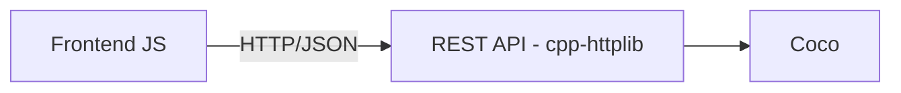

# Coco

Engine and REST API for an N-Puzzle (8-puzzle generalized to an NxN board) written in C++. Generates solvable random boards, supports predefined or custom goal states, and solves the puzzle using A*, returning both the move sequence and intermediate states.

## Demo

[Live demo link]


## Features

- Random initial board generation, guaranteed solvable.
- 5 predefined goal types, plus support for custom user-defined goals.
- Compatibility (solvability) validation between initial state and goal.
- Move generator from a board.
- Optimal solving via A* with Manhattan distance heuristic.
- Response includes the full move sequence and intermediate states.

## Architecture



The engine has no HTTP dependency at all, it only works with in-memory data structures. The API layer is the only part that knows about cpp-httplib and translates between JSON and the engine's structures.

## Tech stack

- **C++17**
- **[cpp-httplib](https://github.com/yhirose/cpp-httplib)** — HTTP server
- **[nlohmann/json](https://github.com/nlohmann/json)** — JSON serialization
- **[Catch2](https://github.com/catchorg/Catch2)** — testing
- **CMake** — build system

## Requirements

- C++17-compatible compiler (GCC 9+, Clang 10+)
- CMake 3.15+
- Git

## Installation and running

```bash
git clone https://github.com/edsoria/coco-engine.git
cd coco-engine
mkdir build && cd build
cmake ..
make
./puzzle_server
```

The server listens on `http://localhost:8080`.

## API documentation

| Endpoint | Method | Description |
|---|---|---|
| `/api/puzzle/new` | POST | Generates a solvable random board for a given size N |
| `/api/puzzle/goal` | GET | Returns the canonical (ordered) goal for a given size N |
| `/api/puzzle/goal-types` | GET | Lists the available predefined goal types |
| `/api/puzzle/move` | POST | Given a board, returns the board with the move made |
| `/api/puzzle/validate` | POST | Checks whether an initial/goal pair is solvable together |
| `/api/puzzle/solve` | POST | Solves with A* and returns moves + intermediate states |

Full contract, including request/response examples and error handling: [docs/API.md](docs/API.md).

## Tests

```bash
cd build
ctest
```

or run the test binary directly:

```bash
./tests/puzzle_tests
```

Current coverage: board generation, solvability validation, base solver cases (already-solved puzzle, unsolvable puzzle, different board sizes).

## Algorithm

Solving is done with **A\*** using the **Manhattan distance** heuristic (sum of each tile's distance from its target position), which is admissible and guarantees the optimal solution (minimum number of moves).

Before attempting to solve, the (initial, goal) pair is validated for solvability via inversion count and blank-tile position, this avoids running an expensive search on a puzzle that has no possible solution.

## Project structure

```
coco-engine/
├── CMakeLists.txt        # build configuration
├── README.md
├── .gitignore
├── Dockerfile            # for deployment 
├── include/puzzle/       # headers 
│   ├── board.hpp
│   ├── solver.hpp
│   └── goals.hpp
├── src/                  # implementation
│   ├── board.cpp
│   ├── solver.cpp
│   ├── goals.cpp
│   ├── api.cpp           # HTTP routes, the only layer aware of cpp-httplib
│   └── main.cpp          # server bootstrap
├── tests/                # unit tests (Catch2)
├── third_party/          # header-only libraries (httplib, json, catch2)
└── docs/
    └── API.md            # full API contract
```

## Roadmap

- [ ] Support for larger boards (5x5+) with additional optimizations (IDA*, walking distance).
- [ ] Docker deployment on Render/Fly.io.